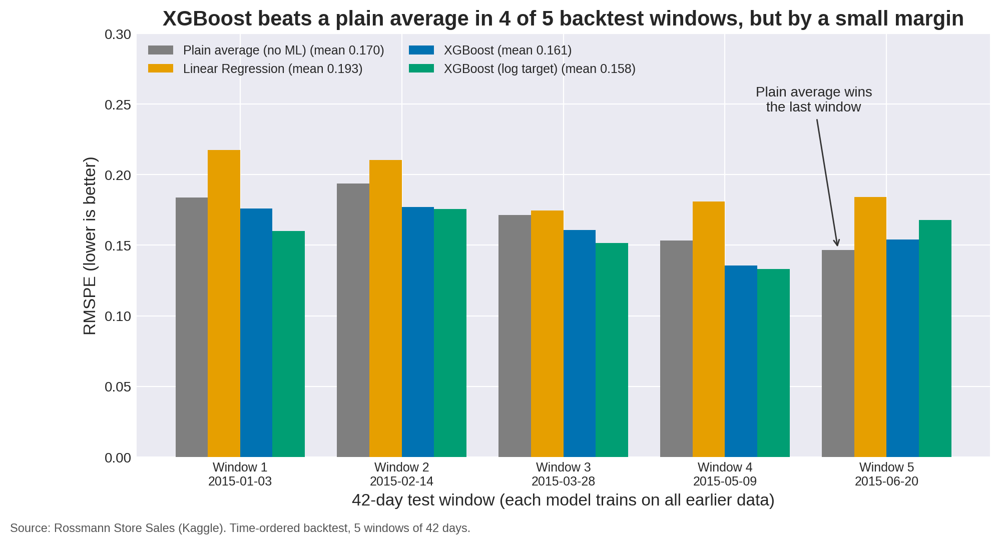
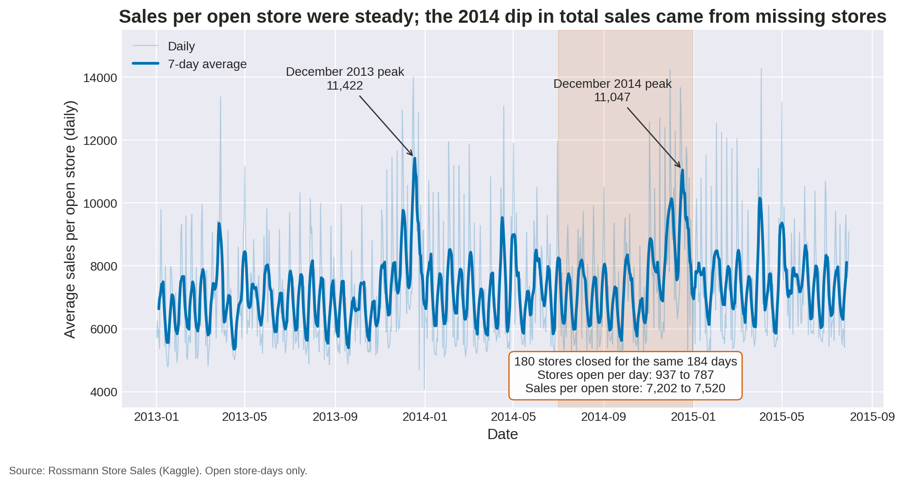
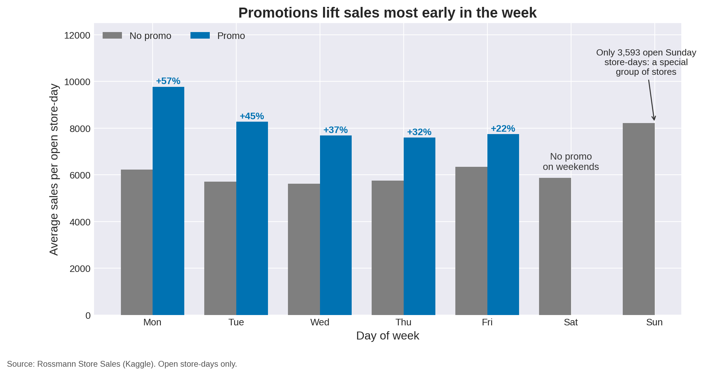
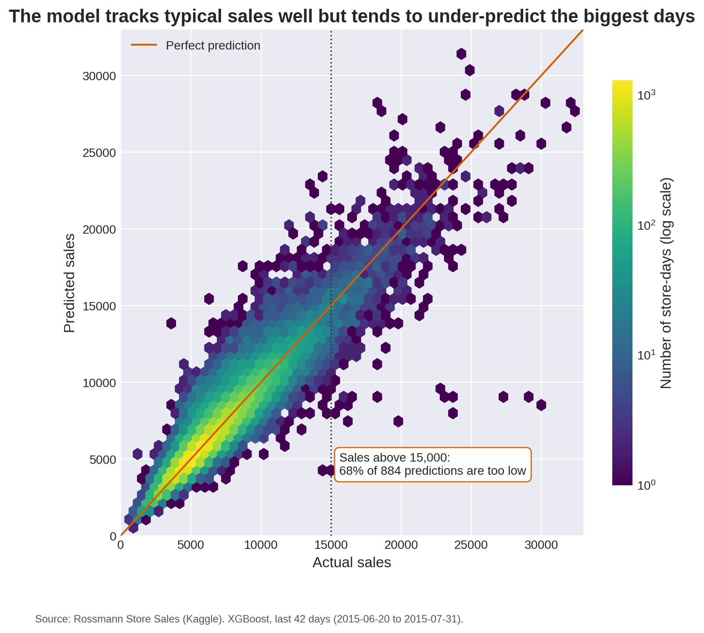
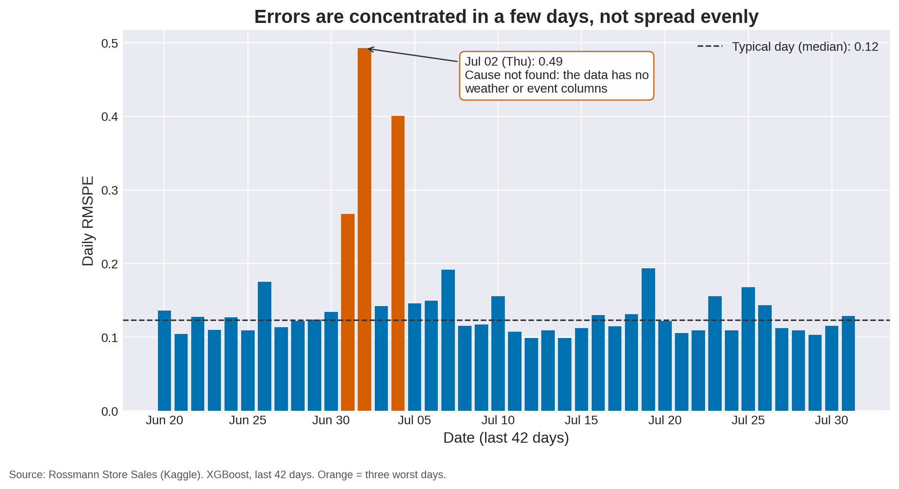

# Rossmann Store Sales Prediction

**Forecasting daily sales for 1,115 drug stores, 6 weeks ahead, and testing whether machine learning really beats a simple average.**



*Result in one picture: XGBoost beats a plain store + weekday + promo average in 4 of 5 backtest windows, but only by a small margin.*

## Problem Statement

Rossmann store managers need to know their **daily sales up to 6 weeks ahead**, to plan staff, stock, and promotions.

- **Task:** supervised regression on time-ordered data
- **Target:** `Sales` (turnover of one store on one day)
- **Metric:** **RMSPE** (root mean squared percentage error), the Kaggle metric. It measures relative error, so a miss on a small store counts as much as the same percentage miss on a big one. RMSE and MAE are reported too
- **Validation:** a **time-ordered backtest**, never a random split. Each of 5 folds trains on everything before a 42-day window and tests on that window

## Dataset

[Rossmann Store Sales](https://www.kaggle.com/c/rossmann-store-sales/data) (Kaggle).

| | |
|---|---|
| `train.csv` | 1,017,209 rows, 1,115 stores, 2013-01-01 to 2015-07-31 |
| `store.csv` | 1,115 rows: store type, assortment, competition distance, Promo2 |
| Rows used for modeling | 844,338 open store-days (closed days always have zero sales) |

The raw data is **not included** in this repo (competition data rules). See [`data/README.md`](data/README.md). The notebooks download a public copy automatically if the files are missing.

## Approach

1. **EDA** ([`01_eda`](notebooks/01_eda.ipynb)): define the problem first, then explore structure, missing values, closed days, sales over time, weekday, month, store, and promo effects. Set simple baselines
2. **Feature engineering** ([`02_feature_engineering`](notebooks/02_feature_engineering.ipynb)): date features, store details, lag features that respect the 6-week horizon, one-hot encoding, a correlation check, and store history features
3. **Modeling** ([`03_modeling`](notebooks/03_modeling.ipynb)): Linear Regression and XGBoost in leak-free pipelines, a 5-window backtest, residual analysis, and feature importance
4. **Final figures** ([`04_final_figures`](notebooks/04_final_figures.ipynb)): the five figures below

## Key Findings

- **Data traps:** 17% of rows are closed days with zero sales. `Customers` is a leak (correlation 0.82 with sales, but unknown at forecast time), so it is not used
- **Promotions:** sales are higher on promo days, with an uplift of about +57% on Mondays down to +22% on Fridays. There are no promo days on weekends
- **A dip that is not a demand story:** total sales per day fell about 13% in Jul to Dec 2014 (6.52M to 5.66M), but 180 stores were closed for the same 184 days. Sales per *open* store rose from 7,202 to 7,520
- **Lags must match the forecast horizon:** `lag_1` and `lag_7` are known for only 2.8% and 16.7% of rows in a 6-week forecast. Only lags of 42 days or more are safe. Promo status matches today's 25% of the time one week back, but 85% of the time two weeks back, so even-week lags carry more signal
- **Features matter:** on one validation window, RMSPE went from 0.364 (raw columns) to 0.174 (date, store, safe lags) to 0.148 (plus store history). Adding the unusable `lag_1`/`lag_7` looked better (0.131), but that score cannot be reproduced in a real forecast
- **A plain average is hard to beat:** an average of sales by store, weekday, and promo flag (no machine learning) beat Linear Regression in all 5 windows. XGBoost beat it in 4 of 5 windows, by margins smaller than the window-to-window spread
- **Errors are not even:** they are concentrated on a few days (July 1 to 4, 2015, cause not found in the data) and on the very biggest sales days (68% of 884 predictions above 15,000 were too low, with a median shortfall of about 5%)

## Results

Mean and standard deviation over 5 backtest windows of 42 days (lower is better):

| Method | RMSE | RMSPE |
|---|---|---|
| Plain average (store x weekday x promo, no ML) | 1,127 +/- 220 | 0.170 +/- 0.020 |
| Linear Regression | 1,200 +/- 161 | 0.193 +/- 0.019 |
| XGBoost (200 trees) | 1,043 +/- 149 | 0.161 +/- 0.017 |
| XGBoost (200 trees, log target) | 1,053 +/- 152 | **0.158 +/- 0.016** |

Last window only (2015-06-20 to 2015-07-31):

| Method | RMSE | MAE | R2 | RMSPE |
|---|---|---|---|---|
| Plain average | 1,109 | 744 | 0.868 | **0.147** |
| Linear Regression | 1,199 | 866 | 0.846 | 0.184 |
| XGBoost (200 trees) | 1,054 | 736 | 0.881 | 0.154 |
| XGBoost (200 trees, log target) | 1,167 | 777 | 0.854 | 0.168 |

The two XGBoost versions are effectively tied. All models use mostly default settings (no tuning).

## Figures

| | |
|---|---|
|  |  |
| **1.** Sales per open store, and the 2014 window with 180 stores missing | **2.** Promotion uplift by weekday |
|  |  |
| **4.** Actual vs predicted sales, last 42 days | **5.** Daily error: a few days stand out |

Figure 3 (model comparison) is at the top of this page.

## How to Run

Tested with Python 3.12, scikit-learn 1.8, pandas 3.0, XGBoost 3.4, NumPy 2.4, and matplotlib 3.10.

```bash
git clone <this-repo-url>
cd Rossmann_Sales_Prediction
python -m venv .venv
source .venv/bin/activate          # on Windows: .venv\Scripts\activate
pip install -r requirements.txt
jupyter notebook
```

Open the notebooks in `notebooks/` and **Run All**, in order: `01` to `04`. Notebook `04` reads results saved by notebook `03`.
On one CPU core, the four notebooks take about 10 seconds, 2.5 minutes, 4 minutes, and 20 seconds. All random seeds are fixed.

## Repo Structure

```
Rossmann_Sales_Prediction/
├── README.md
├── requirements.txt
├── .gitignore
├── data/
│   └── README.md                  (where to get train.csv and store.csv)
├── notebooks/
│   ├── 01_eda.ipynb
│   ├── 02_feature_engineering.ipynb
│   ├── 03_modeling.ipynb
│   └── 04_final_figures.ipynb
├── src/
│   ├── features.py                (date, lag, store, and store-history features)
│   └── modeling.py                (pipelines, baseline, metrics)
└── outputs/
    ├── figures/                   (the five final figures)
    ├── eda/  features/  modeling/ (exploratory charts from each notebook)
    └── results/                   (backtest metrics as CSV)
```

## Limitations and Next Steps

- No hyperparameter tuning yet, and only five test windows, all in 2015
- Store-average features include each training row's own sales (a mild in-sample leak), an out-of-fold version would be cleaner
- No weather, regional holiday, or event data, so days like July 2, 2015 cannot be explained
- Not submitted to the Kaggle leaderboard
- Ideas: tune XGBoost, use `Promo2` and promo-interval details, add out-of-fold store history, and report prediction intervals

## About

Project 1 of my 90-day data science learning journey (learning in public).
[Add your name and LinkedIn link here]
