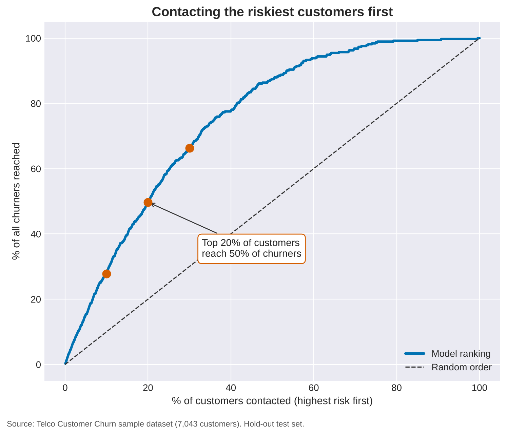
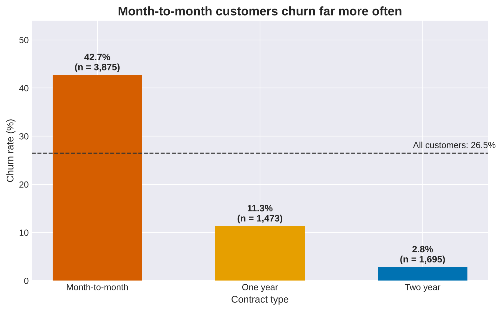
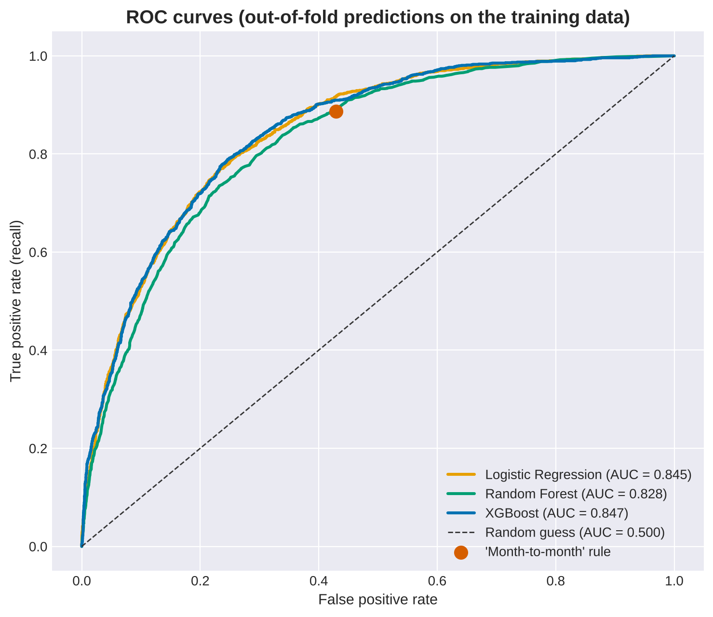
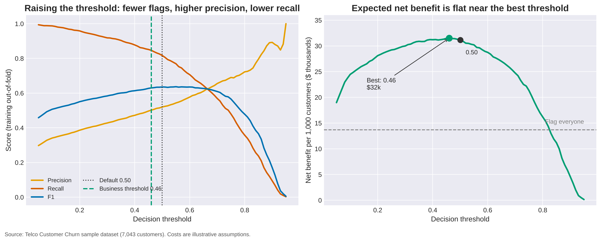
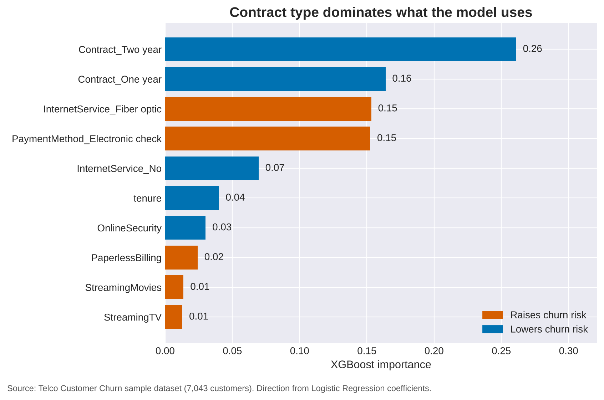
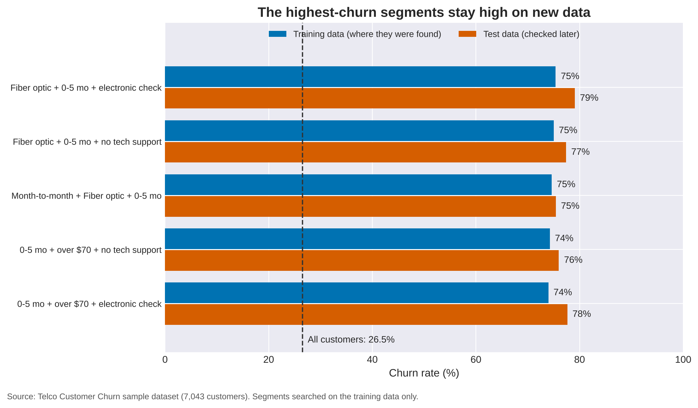
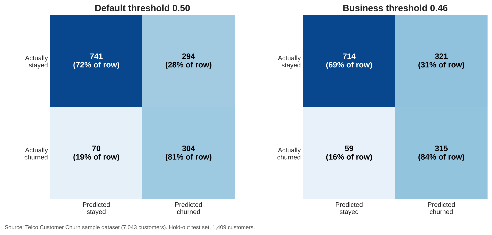

# Telco Customer Churn Prediction

**Finding the customers most likely to leave, and deciding who to contact first.**



*Result in one picture: on a hold-out test set, contacting the 20% of customers with the highest risk score reaches about half (49.7%) of all churners.*

## Problem Statement

A telecom company loses customers every month. If it can spot the ones **likely to leave**, a retention team can reach out first.

- **Task:** binary classification (`Churn`: Yes or No)
- **Class balance:** 26.5% of customers churned (1,869 of 7,043), a ratio of 2.77 : 1
- **Metrics:** ROC-AUC, PR-AUC, recall, precision, and F1. **Not accuracy**: always predicting "No" is 73.5% accurate and catches 0 of the 1,869 churners
- **Validation:** a stratified 80/20 split. All choices (model, settings, threshold, customer segments) were made on the **training** data, and the 1,409 test customers were used once, to report results

## Dataset

[Telco Customer Churn](https://www.kaggle.com/datasets/blastchar/telco-customer-churn), a sample dataset of 7,043 customers and 21 columns (contract, tenure, services, payment method, charges, churn).
The raw file is **not included** in this repo, see [`data/README.md`](data/README.md). The notebooks download a public copy automatically if the file is missing.

## Approach

1. **EDA** ([`01_eda`](notebooks/01_eda.ipynb)): define the problem first, check the data, the class imbalance, and churn by contract, tenure, and charges. Check for confounding. Set simple rule baselines
2. **Preprocessing** ([`02_preprocessing_pipeline`](notebooks/02_preprocessing_pipeline.ipynb)): fix `TotalCharges`, encode, and build one leak-free pipeline. Test class weights and new features
3. **Models** ([`03_model_comparison`](notebooks/03_model_comparison.ipynb)): Logistic Regression, Random Forest, and XGBoost, compared with repeated cross-validation. Tune the best one with `GridSearchCV`, then check it once on the test set
4. **Insights** ([`04_business_insights`](notebooks/04_business_insights.ipynb)): confusion matrices, a business threshold, cumulative gains, churn drivers, and customer segments

## Key Findings

- **Contract type is the strongest signal.** Churn is 42.7% for month-to-month, 11.3% for one-year, and 2.8% for two-year contracts. The gap holds inside every tenure group, so it is not just a tenure effect
- **New customers leave most.** Churn falls from 47.4% (0 to 12 months) to 9.5% (49 to 72 months)
- **Monthly charges are confounded.** Churners pay more on average (median $80 vs $64), but inside DSL and inside fiber optic, higher charges go with *lower* churn. Fiber customers pay more and churn more, which makes price look like the cause
- **Two silent data traps.** `TotalCharges` was stored as text (11 blanks, all brand-new customers). And a plain `map({'Yes': 1, 'No': 0})` would have turned 1,526 values into NaN in each of 6 columns, because of a third value, "No internet service"
- **Class weights shift the balance, not the ranking.** Recall rose from 0.52 to 0.82 and precision fell from 0.67 to 0.51, while ROC-AUC stayed at 0.847
- **The models are nearly tied.** XGBoost and Logistic Regression score alike, Random Forest is behind and overfits (train 1.000, cross-validated 0.828). Tuning barely changed anything
- **A one-line rule is a strong baseline.** "Month-to-month means churn" catches 88.6% of churners (precision 42.7%), and sits almost on the model curves in the ROC chart
- **The business threshold matters less than the cost assumptions.** The expected-benefit curve is flat between thresholds 0.39 and 0.49, but the best threshold ranges from 0.10 to 0.95 as the cost of an offer and its success rate change
- **Brand-new fiber customers are the highest-risk group.** Segments such as "fiber optic + 0 to 5 months + electronic check" churn at 74% to 79%, on both the training and the test data

## Results

Cross-validated results on the training data (5 folds x 3 repeats, same folds for every model):

| Model | ROC-AUC | PR-AUC |
|---|---|---|
| Logistic Regression | 0.846 +/- 0.012 | 0.660 +/- 0.017 |
| Random Forest | 0.828 +/- 0.013 | 0.620 +/- 0.030 |
| XGBoost | 0.847 +/- 0.013 | 0.665 +/- 0.021 |

The final model is the tuned XGBoost. On the **hold-out test set** (1,409 customers, looked at once): **ROC-AUC 0.846** (95% bootstrap interval 0.823 to 0.867), PR-AUC 0.660.

Decision thresholds on the test set (the business threshold, 0.46, was chosen on the training data):

| Threshold | Flagged | Churners caught | False alarms | Precision | Recall | F1 | Net benefit per 1,000 customers* |
|---|---|---|---|---|---|---|---|
| 0.50 (default) | 598 | 304 of 374 | 294 | 0.508 | 0.813 | 0.626 | $30,561 |
| 0.46 (business) | 636 | 315 of 374 | 321 | 0.495 | 0.842 | 0.624 | $31,086 |
| Flag everyone | 1,409 | 374 of 374 | 1,035 | 0.265 | 1.000 | 0.420 | $13,705 |
| Flag nobody | 0 | 0 | 0 | | 0 | | $0 |

\*Net benefit uses **illustrative** costs, not real ones: a saved customer is worth $800, an offer costs $50, and an offer saves 30% of churners. Replace them with real numbers before acting on this.

## Business Insights

These are **associations** from one snapshot, so each should be checked with a small experiment.

1. **Rank, then call.** The top 10% of customers by risk score reach 27.8% of churners, the top 20% reach 49.7%, and the top 30% reach 66.3%
2. **Use the real cost of a mistake.** The threshold depends on what an offer costs and how often it works (see the sensitivity table in notebook 04)
3. **Start with the clear segments.** Month-to-month customers with tenure under 6 months and charges over $70 churn at about 73% vs 26.5% overall (2.8 times higher), and this held on the test set (74.5%)
4. **Test a contract offer.** Longer contracts go with much lower churn. An A/B test of a "switch to an annual plan" offer would show whether that is cause or just who chooses annual plans
5. **Do not read price as the cause.** Within an internet service type, higher charges went with lower churn, so a blanket price cut is not supported by this data

## Figures

| | |
|---|---|
|  |  |
| **3.** Churn rate by contract type | **2.** ROC curves for three models, plus the simple rule |
|  |  |
| **4.** Precision, recall, and expected benefit by threshold | **5.** What the model uses most |
|  |  |
| **6.** High-churn segments, found on training data and checked on test data | **7.** Confusion matrices at the two thresholds |

Figure 1 (cumulative gains) is at the top of this page.

## How to Run

Tested with Python 3.12, scikit-learn 1.9, pandas 3.0, XGBoost 3.4, NumPy 2.5, and matplotlib 3.11.

```bash
git clone <this-repo-url>
cd Customer_Churn_Prediction
python -m venv .venv
source .venv/bin/activate          # on Windows: .venv\Scripts\activate
pip install -r requirements.txt
jupyter notebook
```

Open the notebooks in `notebooks/` and **Run All**, in order: `01` to `04`.
On one CPU core the four notebooks took roughly 10 seconds, 20 seconds, 1.5 minutes, and 10 seconds. All random seeds are fixed.

## Repo Structure

```
Customer_Churn_Prediction/
├── README.md
├── requirements.txt
├── .gitignore
├── data/
│   └── README.md                       (where to get the CSV)
├── notebooks/
│   ├── 01_eda.ipynb
│   ├── 02_preprocessing_pipeline.ipynb
│   ├── 03_model_comparison.ipynb
│   └── 04_business_insights.ipynb
├── src/
│   ├── churn_pipeline.py               (cleaning functions)
│   └── churn_models.py                 (one preprocessing pipeline for any model)
└── outputs/
    ├── figures/                        (the seven figures shown above)
    └── eda/  preprocessing/  modeling/  insights/   (all charts from each notebook)
```

## Limitations and Next Steps

- The cost numbers are illustrative. With real costs the best threshold could change a lot
- Model scores are **not true probabilities** (class weights inflate them), so a probability calibration step is needed before using them in expected-value maths
- One sample dataset, one split, and no time dimension, so drift over time cannot be tested
- The highest-churn segments overlap (they are mostly slices of "new fiber customers"), and each has only 76 to 122 test customers, so their rates are rough
- Everything is an association. Retention offers should be tested in a real experiment
- Ideas: calibrate the probabilities, try SHAP for per-customer explanations, tune Random Forest, and monitor the model on fresh data

## About

Project 2 of my 90-day data science learning journey (learning in public).
[Add your name and LinkedIn link here]
